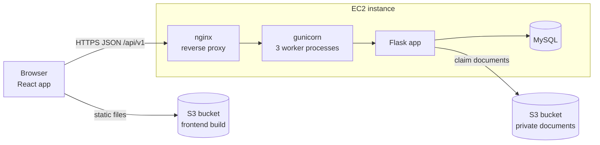
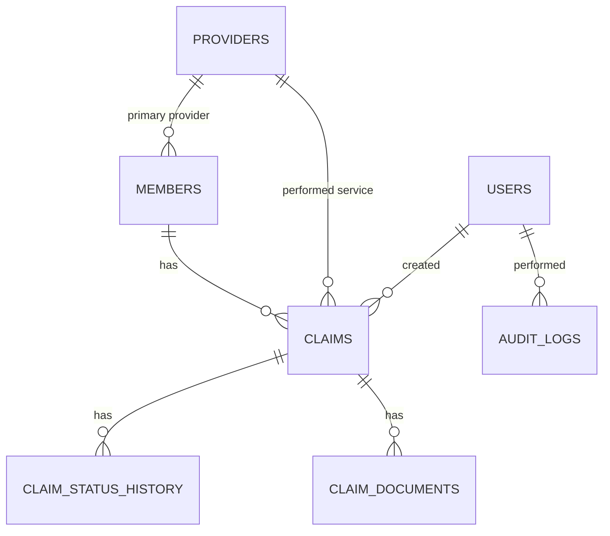

# Architecture and design decisions

This document explains how the system is put together and, more importantly, why. Each decision lists what was chosen, the reason, and what it costs.

## 1. The big picture



There are three tiers:

1. **Presentation**: a React single-page app. It is only static files (HTML, JS, CSS), so it is hosted from S3.
2. **Application**: a Flask REST API. It holds all the business rules and is the only thing that talks to the database.
3. **Data**: MySQL for records, S3 for uploaded files.

The frontend and backend share nothing but the API contract in [API.md](API.md). Either side can be changed, tested and deployed without the other.

## 2. What happens on one request

Take "an agent approves a claim":

1. The agent clicks **Approve**. React calls `api.post("/claims/17/transition", {...})` (`frontend/src/api/client.js`), which adds the `Authorization: Bearer <token>` header.
2. nginx receives the request on port 80 and forwards it to gunicorn on `127.0.0.1:8000`.
3. A gunicorn worker passes it to Flask. Flask matches the URL to `transition()` in `backend/app/claims/routes.py`.
4. The `@roles_required("admin", "agent")` decorator verifies the token's signature and expiry, loads the user from the database, and checks the role.
5. The route validates the JSON body, then loads the claim with `SELECT ... FOR UPDATE` (a row lock).
6. `transition_claim()` in `claims/service.py` enforces the business rules, updates the claim, and adds a history row.
7. An audit-log row is added. One `COMMIT` saves the claim, the history row and the audit row together.
8. The route returns the updated claim as JSON. React re-renders the page.

If any step fails, an `ApiError` is raised, the transaction is rolled back, and the client gets the standard JSON error.

## 3. Backend structure

```
backend/app/
  __init__.py      application factory (create_app)
  config.py        settings from environment variables
  extensions.py    db, jwt, cors objects
  models.py        tables
  validation.py    pure input-checking functions
  errors.py        ApiError and the JSON error handlers
  utils.py         pagination, audit helper
  storage.py       S3 / local file storage
  cli.py           flask init-db, seed, create-admin
  auth/            login, role decorators
  members/         module 1
  providers/       module 1
  claims/          module 2 (routes.py = HTTP, service.py = business rules)
  dashboard/       module 3
  admin/           module 3
```

### Application factory
`create_app(config)` builds the app instead of creating a global `app` at import time. Tests call it with `TestConfig` and get an isolated app with its own database; production calls it once from `wsgi.py`.

### Blueprints
Each module is a Flask Blueprint in its own folder. A new module is a new folder plus one line in `create_app`. Two developers working on claims and on admin tools rarely touch the same file.

### Routes are thin; rules live in a service
`claims/routes.py` deals with HTTP: parse, check permission, call the service, format the response. `claims/service.py` holds the state machine and knows nothing about HTTP. That is why the rules can be unit tested without a web request, and why `flask seed` can reuse them to produce valid demo data.

## 4. Data model



The full DDL is in [`database/schema.sql`](../database/schema.sql).

| Decision | Why | Cost |
|---|---|---|
| Money columns are `DECIMAL(10,2)`; the API sends money as strings | Floats cannot represent most decimal fractions exactly (`0.1 + 0.2 != 0.3`). Claims amounts must add up to the cent. | A little more parsing code on both sides. |
| Timestamps are stored in UTC and converted in the browser | One unambiguous time in the database, whatever the server's or user's timezone. | The UI must format every timestamp. |
| Members are soft-deleted (`status = inactive`) | Claims reference members, and member and claim records must be kept. | Queries that want only current members must filter on status. |
| `claim_status_history` is a separate table | A claim's current status is one value, but the question "who approved this and when" needs every past change. | One extra insert per status change. |
| `audit_logs` rows are written in the same transaction as the change | The change and its audit record are saved together or not at all. There can be no change without a record. | The audit table grows without limit; a real system would archive old rows. |
| Indexes on `members.last_name`, `claims.member_id`, `claims.provider_id`, and `(status, created_at)` on claims | These are the columns the list screens filter and sort by. Without an index MySQL reads every row. | Each index makes inserts slightly slower and uses disk space. |
| Human-readable numbers (`MBR-...`, `CLM-...`) separate from the integer primary key | The integer `id` is compact and fast for joins; the readable number is what people quote on the phone and can be changed in format later. | Two identifiers per record. |

### Known limitation: search
Search uses `LIKE '%text%'`. A pattern that starts with `%` cannot use a normal index, so it scans the table. That is fine for thousands of rows. For millions, the next step would be a MySQL `FULLTEXT` index or a search service.

## 5. Security

| Topic | What the code does | Where |
|---|---|---|
| Passwords | Stored only as salted hashes (Werkzeug `generate_password_hash`). Never logged, never returned by the API. | `models.py` |
| Login errors | The same message for wrong email, wrong password and deactivated account, so the endpoint does not reveal which emails exist. | `auth/routes.py` |
| Authentication | Signed JWT access tokens, 60-minute expiry. | `auth/` |
| Authorization | Role checks on the server for every endpoint. The user is re-read from the database on each request, so deactivating an account or changing a role takes effect at once. | `auth/decorators.py` |
| SQL injection | All queries go through SQLAlchemy with bound parameters; user text is never concatenated into SQL. There is a test that sends `' OR '1'='1`. | everywhere |
| XSS | React escapes all text it renders. The app never uses `dangerouslySetInnerHTML`. | frontend |
| CORS | Only the origins listed in `CORS_ORIGINS` may call the API from a browser. | `__init__.py` |
| File uploads | Extension allow-list, 5 MB limit, `secure_filename`, random storage key, files stored outside the web root, downloads require a token. | `claims/routes.py`, `storage.py` |
| CSV injection | Cells starting with `= + - @` are prefixed with `'` so spreadsheet programs do not run them as formulas. | `admin/routes.py` |
| Secrets | Read from environment variables. `.env` is git-ignored. On EC2, S3 access comes from an IAM role, so there are no AWS keys on the server. | `config.py`, `storage.py` |
| Error details | Unexpected errors are logged with a stack trace on the server; the client gets a generic 500. | `errors.py` |

### Trade-off: where the browser keeps the token
The React app keeps the JWT in `localStorage` and sends it in a header.

- **Advantage:** simple, works when the frontend (S3) and API (EC2) are on different domains, and is not exposed to CSRF because the browser never attaches the token automatically.
- **Risk:** any JavaScript running on the page can read `localStorage`, so an XSS bug would expose the token.
- **Mitigations here:** React's escaping, no third-party scripts, short token lifetime.
- **Alternative:** an `HttpOnly`, `Secure`, `SameSite` cookie, which JavaScript cannot read. That needs CSRF protection and the same site for frontend and API. For a system with real patient data that is the option to choose.

### Trade-off: JWT versus server-side sessions
A JWT is "stateless": the server can verify it without a lookup. The usual drawback is that a token cannot be revoked before it expires. This app loads the user on every request anyway (one primary-key lookup), which gives immediate revocation at a small cost. What is still missing is "sign out everywhere" for a single stolen token; that would need a token deny-list.

### What a real healthcare deployment would add
This project uses synthetic data only. Real member data in the US is covered by HIPAA and would additionally need, among other things: HTTPS everywhere, encryption at rest for the database, multi-factor authentication, login rate limiting and lockout, access logging for every *read* of a record (this app audits writes), automatic session timeout, and signed agreements with the hosting provider.

## 6. Concurrency: two agents, one claim
Two agents open the same claim. One clicks Approve, the other Deny, at the same moment.

Without protection, both requests read `status = in_review`, both pass the check, and the second write silently overwrites the first.

The transition endpoint loads the claim with `SELECT ... FOR UPDATE`. The first transaction locks the row. The second waits until the first commits, then reads `status = approved`, and the state machine rejects "approved to denied" with a 409. The second agent sees an error and the page shows the real status.

This is pessimistic locking. The alternative, optimistic locking, adds a `version` column and rejects a write if the version changed since it was read; it avoids holding locks and suits rarely-conflicting edits such as the member form (which today is last-write-wins).

## 7. Frontend structure

```
frontend/src/
  api/client.js          every HTTP call; adds the token; one ApiError type
  api/useApi.js          hook: load data, track loading/error, ignore stale responses
  context/AuthContext.jsx  who is signed in; login/logout
  components/            Layout, forms, small UI pieces
  pages/                 one file per screen
  utils/                 formatting, debounce
```

- **Routing** is client-side (React Router). `RequireAuth` redirects to `/login` when there is no user and remembers where the user was going.
- **State** is kept local to each page with `useState`. The only global state is the signed-in user, in a Context. A state library (Redux, Zustand) would add ceremony this app does not need yet.
- **The UI asks the server what is allowed.** The claim page renders one button per entry in `allowed_transitions`. The workflow rules exist in one place, the backend, and the UI cannot drift from them.
- **Hiding a button is not security.** Role checks in React only improve the experience. Every rule is enforced again by the API.
- **Search boxes are debounced** (300 ms) and `useApi` discards responses that arrive out of order.

## 8. Testing strategy

| Layer | Tool | What it covers |
|---|---|---|
| Unit | PyTest | Validators, claim state machine, model helpers. No HTTP. |
| Integration | PyTest + Flask test client | Full request path: routing, auth, validation, database, JSON. Includes permission tests for every role, and the `flask` CLI commands. |
| Unit | Vitest | Frontend formatting and query-string helpers. |
| Unit | JUnit 5 | Java claim-file validator (three test classes). |

Each PyTest test gets an empty database. Locally that is in-memory SQLite, so the suite needs no setup and runs in seconds. In CI the same suite runs again against a real MySQL container, because SQLite and MySQL differ (types, locking, case sensitivity) and production runs MySQL.

Not covered: browser end-to-end tests (Playwright or Cypress would be the next addition) and load tests.

## 9. Deployment architecture and its limits

See [DEPLOYMENT.md](DEPLOYMENT.md) for the steps. In short: the frontend build is synced to an S3 bucket; the API runs on one EC2 instance as `nginx -> gunicorn -> Flask`, with MySQL on the same instance; claim documents go to a private S3 bucket through the instance's IAM role.

This is deliberately the smallest setup that works. Its limits, and the usual next step for each:

| Limit | Next step |
|---|---|
| One EC2 instance is a single point of failure | Two or more instances in different availability zones behind an Application Load Balancer. The app is already stateless (tokens, files in S3), so this needs no code change. |
| MySQL on the same instance; backups are manual | Amazon RDS for MySQL: automated backups, patching, optional standby replica. |
| HTTP only | A domain, an ACM certificate, CloudFront in front of S3 and the load balancer. |
| Deploy restarts gunicorn (a second or two of errors) | Rolling deploys behind the load balancer, or a graceful gunicorn reload (HUP signal) that replaces workers one by one. |
| `db.create_all()` cannot change existing tables | Add Alembic (Flask-Migrate) for versioned schema migrations. |
| Long-lived AWS keys in GitHub secrets | GitHub OIDC with a short-lived IAM role. |
| Logs stay on the instance | Ship to CloudWatch Logs; add alarms on 5xx rate and the health check. |

## 10. The Java tool

`tools/claim-file-validator` is a small standalone Java program. It reads the claims CSV export and checks every row against the same rules the API enforces (NPI check digit, code formats, amounts, status-dependent rules, duplicate claim numbers). It is meant to run before an export is handed to another system: exit code 0 means the file is clean.

It is separate from the web app on purpose. It has no dependencies beyond the JDK, so it can run anywhere a file lands. The cost is that the rules exist in two languages; the NPI test cases are the same in both test suites to keep them in step.
